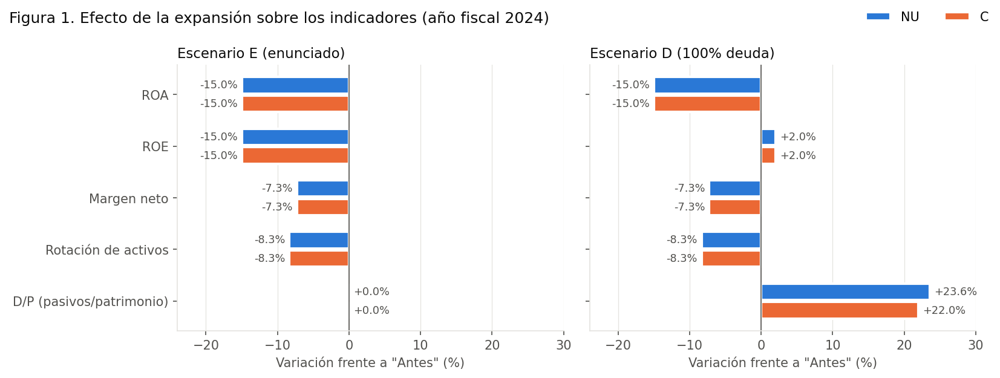
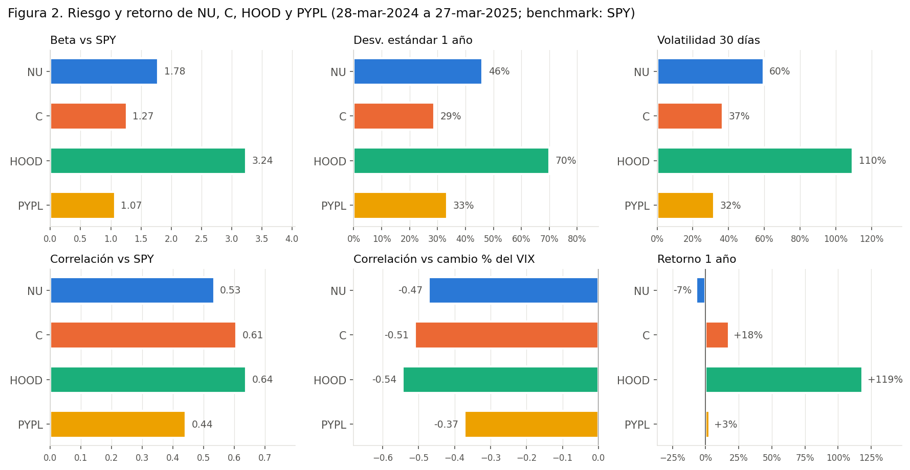
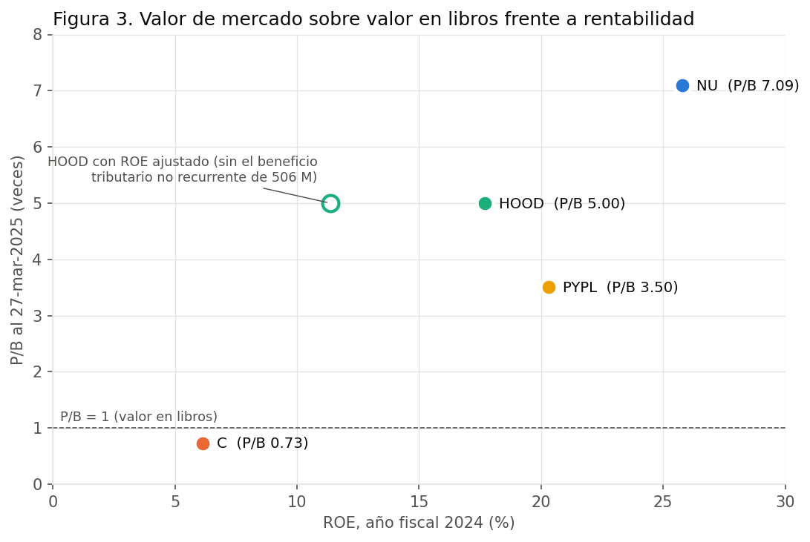
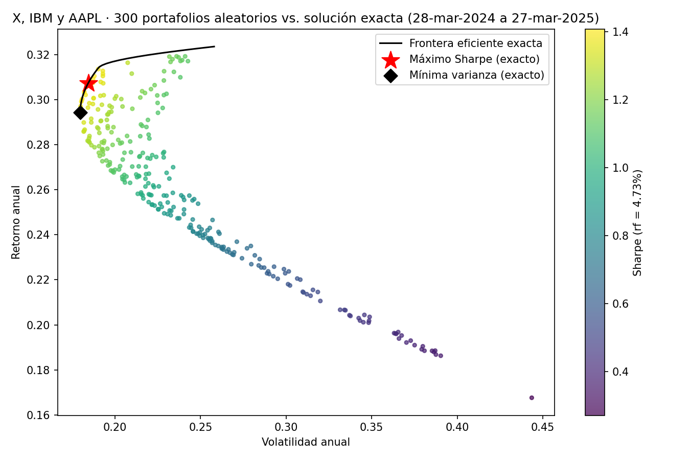
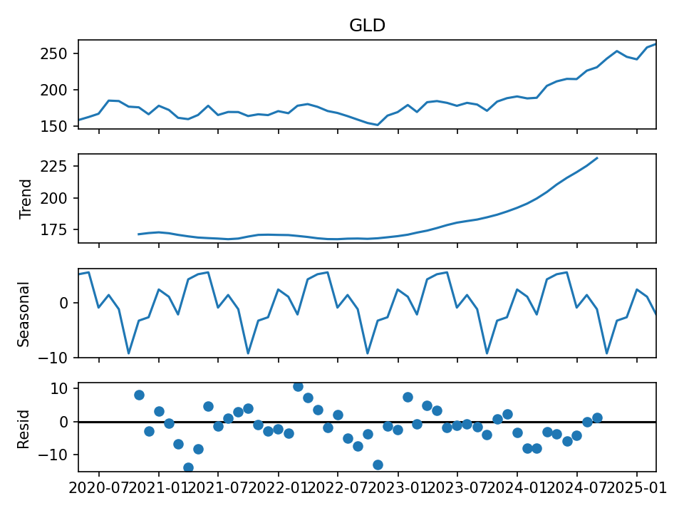
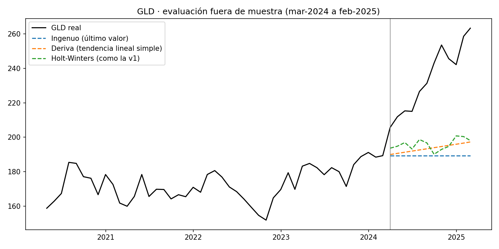
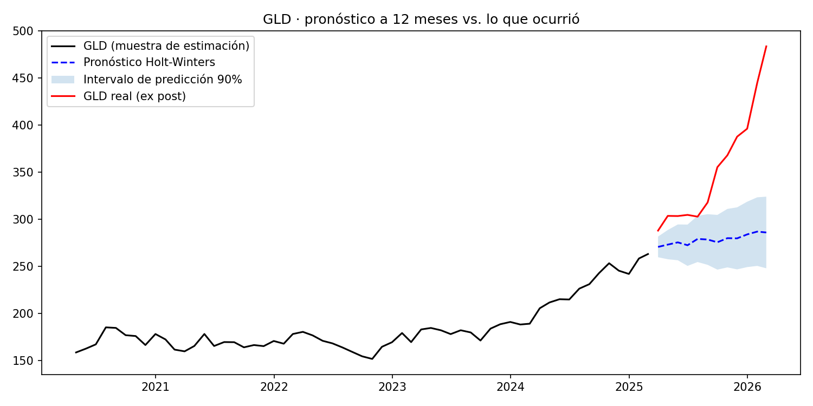
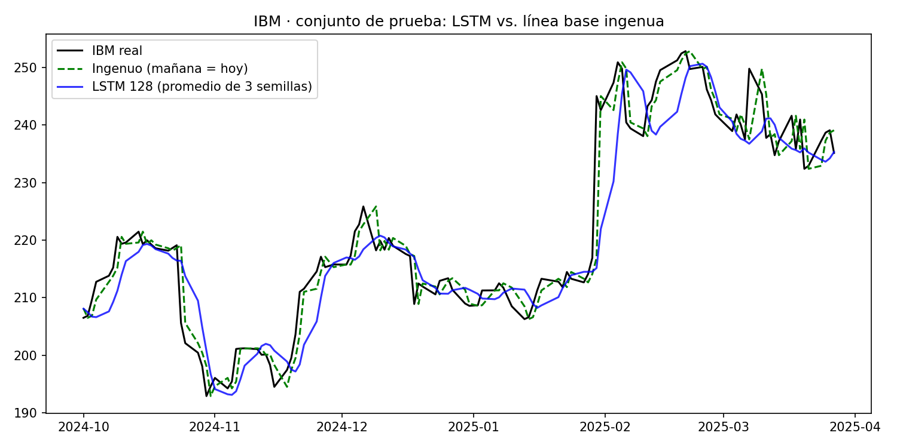
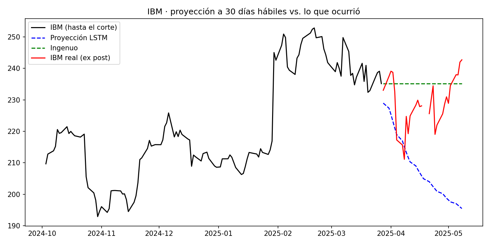

# Simulación financiera: estructura de balance, riesgo de mercado, selección de portafolio y pronóstico de precios (versión 2)

**Juan Carlos Salas** · Finanzas y Negocios Internacionales, Universidad de Manizales · [github.com/sugarcode25](https://github.com/sugarcode25)

## Resumen

Este repositorio presenta la segunda versión de un taller académico de Simulación Financiera desarrollado en marzo de 2025. El taller consta de cuatro ejercicios: la simulación de una expansión de activos financiada con deuda en Nu Holdings (NU) y Citigroup (C); la comparación de valoración, rentabilidad y riesgo de cuatro empresas del sector financiero; la construcción de un portafolio de máxima razón de Sharpe mediante simulación Monte Carlo; y el pronóstico de precios de GLD e IBM. La primera versión contenía errores contables, de programación y de validación estadística que alteraban sus conclusiones. En esta versión cada ejercicio se reconstruye a partir de fuentes primarias (estados financieros radicados ante la Comisión de Bolsa y Valores de Estados Unidos [SEC] y series de precios con fecha de corte fija), se incorporan controles de coherencia en el código y se declaran las limitaciones de cada análisis.

Los resultados principales son cuatro. Primero, bajo los supuestos del enunciado la expansión reduce en 15% la rentabilidad sobre activos (ROA) y la rentabilidad sobre patrimonio (ROE), en lugar de "amplificar el patrimonio" como afirmaba la primera versión. Segundo, las métricas de riesgo de la primera versión no se habían calculado; estimadas con datos de mercado, la correlación con el índice de volatilidad del mercado (VIX) resulta negativa para las cuatro empresas. Tercero, un error de indexación hacía que la primera versión reportara pesos que no correspondían al portafolio óptimo. Cuarto, ninguna de las configuraciones de la red neuronal de memoria a corto y largo plazo (LSTM) supera al pronóstico ingenuo ("el precio de mañana es igual al de hoy") en el caso de IBM.

**Abstract.** This repository contains the second version of a 2025 university workshop in Financial Simulation. It comprises four exercises: a debt-financed asset expansion for Nu Holdings and Citigroup, a valuation and risk comparison of four financial stocks, a Monte Carlo maximum-Sharpe portfolio, and price forecasts for GLD and IBM. The first version contained accounting, coding and statistical-validation errors that changed its conclusions. This version rebuilds each exercise from primary sources (SEC filings and price series with a fixed cut-off date), adds internal consistency checks, and states its limitations. Under the course assumptions, the expansion lowers ROA and ROE by 15%. The computed correlation with the VIX is negative for all four stocks, contrary to the hand-typed values of the first version. An indexing bug caused the first version to report incorrect portfolio weights. No LSTM configuration outperforms a naive random-walk forecast for IBM.

**Palabras clave:** análisis de estados financieros, beta, optimización de portafolio, simulación Monte Carlo, suavizamiento exponencial, LSTM, validación fuera de muestra.

**Abreviaturas**

| Abreviatura | Significado |
|---|---|
| ADF | Prueba de Dickey-Fuller aumentada |
| ETS | Modelo de suavizamiento exponencial en espacio de estados (error, tendencia, estacionalidad) |
| IFRS / US GAAP | Normas Internacionales de Información Financiera / principios contables generalmente aceptados en Estados Unidos |
| LSTM | Red neuronal de memoria a corto y largo plazo (*long short-term memory*) |
| MAE / MAPE / RMSE | Error absoluto medio / error porcentual absoluto medio / raíz del error cuadrático medio |
| P/B / P/E | Precio sobre valor en libros / precio sobre utilidad |
| ROA / ROE | Rentabilidad sobre activos / rentabilidad sobre patrimonio |
| SEC | Comisión de Bolsa y Valores de Estados Unidos (*Securities and Exchange Commission*) |
| SES | Suavizamiento exponencial simple |
| UPA | Utilidad por acción |
| VIX | Índice de volatilidad implícita del S&P 500 (Cboe) |
| XBRL | Lenguaje extensible de informes financieros (*eXtensible Business Reporting Language*) |

Convención numérica: se emplea el punto como separador decimal y la coma como separador de miles, como en los estados financieros fuente. Las cifras monetarias están en dólares estadounidenses (US$).

---

## Introducción

La primera versión de este trabajo (v1; Salas, 2025) se elaboró con apoyo intensivo de un modelo de lenguaje. Su documentación tenía apariencia profesional, pero una auditoría posterior identificó afirmaciones que el código no respaldaba, valores escritos manualmente donde debía haber cálculos, un error de programación en la selección del portafolio y procedimientos de validación que permitían fuga de información. Esta segunda versión (v2) tiene un doble propósito: corregir esos errores y documentar el proceso de corrección como parte de la formación del autor.

La v1 se conserva sin modificaciones en la carpeta `v1/` y en el repositorio archivado [`financial-simulation-and-portfolio-optimization`](https://github.com/sugarcode25/financial-simulation-and-portfolio-optimization), cuyo archivo `ISSUES.md` lista los errores con su severidad y evidencia. En cada ejercicio de este documento se distingue entre lo que exigía el enunciado del curso, lo que el autor añadió por iniciativa propia y lo que se corrigió respecto a la v1. El enunciado original no se conserva; el de cada ejercicio se reconstruyó a partir del informe entregado.

| | Versión 1 (marzo de 2025) | Versión 2 (noviembre de 2026) |
|---|---|---|
| Archivos | `v1/TALLER_FINAL_SM_JUAN_SALAS.pdf`, `v1/taller_2_smf_js.py` | `notebooks/`, `data/`, `outputs/`, este documento |
| Datos | Yahoo Finance consultado al ejecutar, sin copia | SEC EDGAR para la contabilidad; Yahoo Finance, Tiingo y FRED para precios, con fecha de corte y de descarga registradas |
| Estado | Registro histórico, sin cambios | Vigente |

## Datos

| Fuente | Información | Uso |
|---|---|---|
| SEC EDGAR (XBRL y `Financial_Report.xlsx`) | Estados financieros del año fiscal 2024, tal como se radicaron originalmente: informes 10-K de C, PYPL y HOOD e informe 20-F de NU (Citigroup Inc., 2025; Nu Holdings Ltd., 2025; PayPal Holdings, Inc., 2025; Robinhood Markets, Inc., 2025) | Ejercicios 1 y 2 |
| Yahoo Finance (s. f.) | Precios diarios ajustados y sin ajustar de NU, C, HOOD, PYPL, IBM, AAPL, GLD, SPY y el índice VIX | Ejercicios 2, 3 y 4 |
| Tiingo (s. f.) | Precios diarios de U.S. Steel (X), que dejó de cotizar en junio de 2025 | Ejercicio 3 |
| FRED, serie DTB3 (Federal Reserve Bank of St. Louis, s. f.) | Tasa de las letras del Tesoro a 3 meses | Ejercicio 3 |

La fecha de corte de los datos de mercado es el 27 de marzo de 2025, la misma de la v1. Los estados financieros de la SEC son de dominio público y se incluyen en `data/raw/` con su fecha de descarga. Las series de precios no se redistribuyen, por las condiciones de licencia de sus proveedores; el cuaderno contiene las celdas que las descargan. El S&P 500 se aproxima mediante SPY, el fondo cotizado que lo replica, porque la serie del índice no estaba disponible en la fuente; para retornos diarios la diferencia es despreciable.

## Estructura del repositorio y reproducibilidad

```
├── README.md
├── CHANGELOG.md
├── LICENSE
├── v1/                              # Entrega original (marzo de 2025), sin cambios
│   ├── TALLER_FINAL_SM_JUAN_SALAS.pdf
│   └── taller_2_smf_js.py
├── notebooks/
│   └── taller_simulacion_v2.ipynb   # Ejercicios 1 a 4 y figuras
├── data/
│   └── raw/                         # Archivos de la SEC, con fecha de descarga
└── outputs/                         # Tablas (CSV) y figuras (PNG) citadas en este documento
```

El cuaderno se ejecuta en Google Colab. Las consultas a la SEC requieren un encabezado `User-Agent` con un correo de contacto, que el usuario debe reemplazar por el propio. La descarga de los precios de X requiere una clave de Tiingo, que se guarda en los *Secrets* de Colab y nunca en el código. Cada ejercicio se ejecuta en orden después de la celda de conexión a Drive: ejercicio 1, celdas 1 a 6b; ejercicio 2, P2-1 a P2-4; ejercicio 3, P3-1 a P3-6; ejercicio 4, P4-1 a P4-7; figuras de los ejercicios 1 y 2, F-0 a F-3. Las librerías utilizadas (`pandas`, `numpy`, `requests`, `yfinance`, `scipy`, `statsmodels`, `tensorflow` y `matplotlib`) vienen preinstaladas en Colab.

Todas las cifras de este documento provienen de una celda del cuaderno y de un archivo en `outputs/`. El código incluye cuatro controles de coherencia:
- La identidad A − P − E = 0 en todas las empresas.
- La identidad β = ρ · σᵢ / σₘ, que debe devolver la misma volatilidad de mercado para todas las acciones.
- El cálculo del P/B por dos vías independientes.
- La coincidencia entre la beta del portafolio obtenida por suma ponderada y la obtenida por regresión.

---

## Ejercicio 1. Expansión de activos financiada con deuda

### Planteamiento

El enunciado propone simular, para NU y C, una expansión en la que los activos y los pasivos crecen 20%, los ingresos 10% y la utilidad neta 2%, y analizar su efecto sobre la empresa.

### Método

Se utilizaron los estados financieros del año fiscal 2024 tal como se radicaron originalmente (informe 10-K de C, radicado el 21 de febrero de 2025 bajo US GAAP [Citigroup Inc., 2025]; informe 20-F de NU, radicado el 16 de abril de 2025 bajo IFRS [Nu Holdings Ltd., 2025]). Los saldos corresponden al 31 de diciembre de 2024 y los flujos al año completo, de modo que ambas empresas comparten el mismo periodo. Para cada escenario se calcularon el ROA, el ROE, el margen neto, la rotación de activos y la razón pasivos/patrimonio.

Además del escenario del enunciado (escenario E), se añadió por iniciativa propia un escenario D, en el que la compra se financia íntegramente con deuda por el mismo monto en dólares. En ese caso el patrimonio permanece constante, como exige la identidad contable A = P + E. El ROE se calculó con la utilidad total, que incluye a los accionistas minoritarios, sobre el patrimonio total, para que numerador y denominador correspondan a los mismos propietarios.

### Resultados

**Tabla 1**

*Cifras base, año fiscal 2024 (US$ millones)*

| | Activos | Pasivos | Patrimonio total | Ingresos | Utilidad neta |
|---|---|---|---|---|---|
| C | 2,352,945 | 2,143,579 | 209,366 | 81,139 | 12,833 |
| NU | 49,931 | 42,284 | 7,647 | 11,517 | 1,972 |

*Nota.* Elaboración propia. Fuente: Citigroup Inc. (2025) y Nu Holdings Ltd. (2025), etiquetas XBRL `us-gaap:` (C) e `ifrs-full:` (NU). Trazabilidad completa en `outputs/punto1_datos_base_FY2024.csv`.

**Tabla 2**

*Indicadores por escenario*

| Empresa | Escenario | ROA | ROE | Margen neto | Rotación de activos | Pasivos/patrimonio |
|---|---|---|---|---|---|---|
| C | Antes | 0.55% | 6.13% | 15.82% | 0.034 | 10.24 |
| C | E (enunciado) | 0.46% | 5.21% | 14.67% | 0.032 | 10.24 |
| C | D (100% deuda) | 0.46% | 6.25% | 14.67% | 0.032 | 12.49 |
| NU | Antes | 3.95% | 25.79% | 17.12% | 0.231 | 5.53 |
| NU | E (enunciado) | 3.36% | 21.92% | 15.88% | 0.211 | 5.53 |
| NU | D (100% deuda) | 3.36% | 26.30% | 15.88% | 0.211 | 6.84 |

*Nota.* Elaboración propia a partir de la Tabla 1 y de los supuestos de cada escenario.

**Figura 1**

*Variación porcentual de cada indicador respecto al escenario inicial*



*Nota.* Elaboración propia con datos de Citigroup Inc. (2025) y Nu Holdings Ltd. (2025).

**Tabla 3**

*Comparación entre empresas en una base de ingresos homogénea*

| | Ingresos netos de intereses (US$ millones) | Margen neto | ROE |
|---|---|---|---|
| C | 81,139 | 15.82% | 6.13% |
| NU | 8,682 | 22.71% | 25.79% |

*Nota.* Los ingresos de C se reportan netos de gasto por intereses (US GAAP), mientras que los de NU se reportan brutos (IFRS); a estos últimos se les restó el gasto por intereses (US$2,835 millones).

### Discusión

En el escenario del enunciado, la expansión reduce el ROA y el ROE en 15% en ambas empresas (1.02/1.20 − 1), el margen neto en 7.3% y la rotación de activos en 8.3%: incrementar los activos en 20% para obtener un 2% adicional de utilidad deteriora la rentabilidad. La razón pasivos/patrimonio permanece constante porque el supuesto hace crecer el patrimonio en 20% sin aportes de capital ni utilidades nuevas. Ese crecimiento es un efecto mecánico del supuesto, no un resultado económico.

En el escenario D el ROE aumenta ligeramente, porque la utilidad crece 2% sobre un patrimonio constante, mientras el apalancamiento se eleva (de 10.2 a 12.5 veces en C). Este resultado debe interpretarse con cautela: el escenario no imputa el costo financiero de la deuda nueva. En el caso de C, la deuda adicional ascendería a US$470,589 millones. A una tasa ilustrativa del 4% anual, los intereses (US$18,824 millones) superarían la utilidad total de 2024 (US$12,833 millones), de modo que la expansión conduciría a pérdidas. La viabilidad de la expansión depende, por tanto, del costo de la deuda y de la cobertura de intereses resultante.

En una base comparable (Tabla 3), NU obtiene un margen neto y un ROE sustancialmente superiores a los de C.

### Correcciones respecto a la v1

La v1 presentaba como hallazgo un aumento del 31.7% en el patrimonio "por amplificación del apalancamiento". La cifra surgía de comparar el patrimonio total proyectado con el patrimonio común de Citigroup (US$190,748 millones), que excluye las acciones preferentes (US$17,850 millones) y los intereses minoritarios (US$768 millones). Además, la v1 comparaba niveles en lugar de indicadores, combinaba un dato anual de C con uno trimestral de NU y citaba como fuente una API que no había devuelto datos.

<!-- [EN ESPERA, regla de explicabilidad] Nota del ROE común de C (6.10%): se agrega cuando el autor pueda explicar el efecto de las acciones preferentes. -->

### Limitaciones

Los escenarios son estáticos: no incorporan el costo de la deuda, los impuestos ni el riesgo de crédito. El ROE se calcula sobre el patrimonio de cierre y no sobre el promedio del año, lo que subestima el de NU, cuyo patrimonio creció durante 2024. La comparación entre empresas es aproximada porque aplican normas contables distintas. Por último, se detectó que la etiqueta XBRL `ProfitLossFromContinuingOperations` del reporte de NU presenta el signo invertido, por lo que cada etiqueta utilizada se contrastó con los estados financieros oficiales.

---

## Ejercicio 2. Valoración, rentabilidad y riesgo de cuatro empresas financieras

### Planteamiento

El enunciado propone comparar a NU, C, Robinhood (HOOD) y PayPal (PYPL) en valoración, rentabilidad, solvencia y riesgo. El riesgo se mide con la beta, la desviación estándar anual, la volatilidad de 30 días, la correlación con el S&P 500 y la relación con el índice VIX.

### Método

Se emplearon retornos diarios simples entre el 28 de marzo de 2024 y el 27 de marzo de 2025, calculados con precios ajustados por dividendos y divisiones de acciones, y SPY como índice de referencia. La beta se estimó como cov(rᵢ, rₘ)/var(rₘ), con el mismo número de grados de libertad en numerador y denominador. La volatilidad de 30 días corresponde a las últimas 21 sesiones, anualizada. La relación con el VIX se definió como la correlación entre el retorno diario de cada acción y la variación porcentual diaria del índice.

Los indicadores de valoración se calcularon con el precio de cierre sin ajustar del 27 de marzo de 2025 y las cifras del año fiscal 2024 de la SEC. El P/E se obtuvo como precio sobre utilidad por acción diluida. La capitalización se aproximó como precio por número de acciones diluidas promedio. El P/B se calculó por dos vías, capitalización sobre patrimonio y P/E por ROE, como control de coherencia.

### Resultados

**Tabla 4**

*Métricas de riesgo y retorno*

| | Beta vs. SPY | Desv. estándar anual | Volatilidad 30 días | Correlación con SPY | Correlación con el VIX | Retorno a 1 año |
|---|---|---|---|---|---|---|
| NU | 1.78 | 46.1% | 59.5% | 0.53 | −0.47 | −7.0% |
| C | 1.27 | 28.8% | 36.8% | 0.61 | −0.51 | +17.5% |
| HOOD | 3.24 | 70.1% | 109.5% | 0.64 | −0.54 | +118.5% |
| PYPL | 1.07 | 33.5% | 31.9% | 0.44 | −0.37 | +2.8% |

*Nota.* Elaboración propia con datos de Yahoo Finance (s. f.). Periodo: 28 de marzo de 2024 a 27 de marzo de 2025.

**Figura 2**

*Métricas de riesgo y retorno por empresa*



*Nota.* Elaboración propia con datos de Yahoo Finance (s. f.).

Como verificación interna, al despejar la volatilidad del mercado de la identidad β = ρ · σᵢ / σₘ se obtiene 13.80% para las cuatro empresas y para AAPL, valor idéntico a la volatilidad de SPY calculada directamente.

**Tabla 5**

*Valoración y rentabilidad (año fiscal 2024; precio al 27 de marzo de 2025)*

| | Precio (US$) | UPA diluida | P/E | Capitalización aprox. (US$ millones) | ROE | ROA | P/B |
|---|---|---|---|---|---|---|---|
| C | 71.85 | 5.94 | 12.1 | 139,396 | 6.1% | 0.55% | 0.73ᵃ |
| PYPL | 68.86 | 3.99 | 17.3 | 71,546 | 20.3% | 5.08% | 3.50 |
| HOOD | 43.99 | 1.56 | 28.2 (≈ 44 ajustadoᵇ) | 39,862 | 17.7% (11.4% ajustadoᵇ) | 5.39% | 5.00 |
| NU | 11.09 | 0.40 | 27.5 | 54,218 | 25.8% | 3.95% | 7.09 |

*Nota.* ᵃ Calculado sobre el patrimonio común (US$190,748 millones). Sobre el patrimonio total sería 0.67; la diferencia obedece a las acciones preferentes. ᵇ Excluye un beneficio tributario no recurrente de US$506 millones (véase la discusión del Ejercicio 2).

**Figura 3**

*Razón precio/valor en libros frente al ROE*



*Nota.* Elaboración propia con datos de los informes anuales citados y de Yahoo Finance (s. f.). El círculo vacío muestra a HOOD con el ROE ajustado (sin el beneficio tributario no recurrente).

### Discusión

Las cuatro empresas presentan correlaciones negativas con el VIX (entre −0.37 y −0.54): tienden a perder valor cuando aumenta la aversión al riesgo del mercado. HOOD es la más riesgosa en todas las medidas; PYPL presenta la menor beta y la menor volatilidad de corto plazo, y C la menor desviación estándar anual. PYPL es además la menos correlacionada con el mercado.

La Figura 3 muestra que la razón precio/valor en libros se ordena según el ROE: C, con la rentabilidad más baja, cotiza por debajo de su valor contable, mientras NU, con la más alta, lo hace a siete veces. Este patrón es coherente con la identidad P/B = P/E · ROE.

La utilidad de HOOD en 2024 (US$1,411 millones) supera su utilidad antes de impuestos (US$1,064 millones). La diferencia se explica por un beneficio tributario no recurrente de US$506 millones, derivado de la liberación de la provisión de valuación sobre sus impuestos diferidos (Robinhood Markets, Inc., 2025, nota "Income Taxes"). Sin ese efecto, la utilidad sería de US$905 millones y el P/E aumentaría a aproximadamente 44 veces, el más alto del grupo. Estas lecturas describen el periodo analizado y no constituyen recomendaciones de inversión.

### Correcciones respecto a la v1

En la v1, la beta, las volatilidades, la correlación con el mercado y la relación con el VIX eran valores escritos manualmente; en particular, la relación con el VIX aparecía positiva (entre 0.70 y 1.00) y sin definición. La columna de valoración por flujos descontados era un número aleatorio a partir del cual el informe concluía que PYPL estaba sobrevalorada; esa columna se eliminó. Además, el código publicado analizaba a HIMS mientras el informe analizaba a C; la v2 sigue al informe. La razón deuda/patrimonio de C citada en la v1 (49.21%) carecía de fuente.

### Limitaciones

En bancos y empresas de tecnología financiera la razón pasivos/patrimonio refleja principalmente depósitos de clientes, no deuda financiera, por lo que no admite la misma lectura que en una empresa industrial. Las métricas de riesgo dependen de la ventana elegida, y la volatilidad de 30 días, estimada con 21 observaciones, es particularmente inestable. La capitalización es aproximada porque emplea acciones promedio del año. NU reporta bajo IFRS, lo que limita la comparabilidad de sus múltiplos.

---

## Ejercicio 3. Portafolio de máxima razón de Sharpe

### Planteamiento

El enunciado propone construir un portafolio con X (U.S. Steel), IBM y AAPL mediante 100, 200 y 300 portafolios aleatorios, identificar la frontera eficiente y el portafolio de máxima razón de Sharpe (Markowitz, 1952; Sharpe, 1966), y calcular la beta de cada activo y del portafolio.

### Método

El retorno esperado anual se estimó como la media diaria multiplicada por 252, y la matriz de covarianzas anual como la covarianza diaria multiplicada por 252, con datos del 28 de marzo de 2024 al 27 de marzo de 2025. La tasa libre de riesgo es el promedio de la tasa de las letras del Tesoro de Estados Unidos a 3 meses en la ventana, 4.73% (Federal Reserve Bank of St. Louis, s. f.). Los pesos aleatorios, sin posiciones cortas, se generaron con una distribución Dirichlet(1, 1, 1), que cubre de manera uniforme el conjunto de combinaciones posibles; cada tamaño de simulación usa una semilla independiente.

Por iniciativa propia se añadieron dos extensiones: una prueba de ruido de muestreo, que repite cada tamaño 1,000 veces con semillas distintas, y la solución exacta mediante optimización numérica, para contrastar el Monte Carlo. La beta del portafolio se calculó como suma ponderada de las betas individuales y se verificó por regresión.

### Resultados

**Tabla 6**

*Insumos anuales*

| | X | IBM | AAPL |
|---|---|---|---|
| Retorno esperado | 16.4% | 32.4% | 30.5% |
| Volatilidad | 45.6% | 25.8% | 24.5% |
| Beta vs. SPY | 0.69 | 0.71 | 0.96 |

*Nota.* Elaboración propia con datos de Tiingo (s. f.) y Yahoo Finance (s. f.).

**Tabla 7**

*Portafolio de máxima razón de Sharpe (tasa libre de riesgo: 4.73%)*

| | Retorno | Volatilidad | Sharpe | Peso X | Peso IBM | Peso AAPL | Beta |
|---|---|---|---|---|---|---|---|
| Monte Carlo, 100 | 31.26% | 18.91% | 1.40 | 0.6% | 47.1% | 52.3% | 0.840 |
| Monte Carlo, 200 | 30.59% | 18.34% | 1.41 | 5.5% | 47.8% | 46.7% | 0.825 |
| Monte Carlo, 300 | 30.75% | 18.46% | 1.41 | 4.1% | 45.9% | 50.1% | 0.834 |
| Solución exacta | 30.73% | 18.44% | 1.41 | 4.4% | 47.4% | 48.2% | 0.829 |
| Mínima varianza (exacta) | 29.42% | 17.97% | 1.37 | 12.9% | 41.4% | 45.7% | 0.821 |

*Nota.* Elaboración propia. Tasa libre de riesgo: Federal Reserve Bank of St. Louis (s. f.).

**Tabla 8**

*Peso de X en el portafolio óptimo a lo largo de 1,000 repeticiones por tamaño*

| Simulaciones | Media | Desviación estándar | Percentiles 5–95 |
|---|---|---|---|
| 100 | 4.5% | 2.3% | 0.9% – 8.4% |
| 200 | 4.3% | 1.7% | 1.6% – 7.1% |
| 300 | 4.4% | 1.4% | 2.2% – 6.7% |

*Nota.* Elaboración propia. Cada fila resume 1,000 corridas independientes del Monte Carlo.

**Figura 4**

*Portafolios aleatorios, frontera eficiente exacta y portafolios de máximo Sharpe y de mínima varianza*



*Nota.* Elaboración propia con datos de Tiingo (s. f.), Yahoo Finance (s. f.) y Federal Reserve Bank of St. Louis (s. f.). El color de cada punto indica su razón de Sharpe.

### Discusión

El aumento del número de simulaciones no modifica la respuesta, sino su precisión. La media del peso de X se mantiene en torno al 4.4%, que coincide con la solución exacta, mientras su dispersión se reduce de 2.3 a 1.4 puntos porcentuales. Las variaciones entre corridas individuales (0.6%, 5.5% y 4.1%) constituyen ruido de muestreo y no una tendencia. Cerca del óptimo, la razón de Sharpe es prácticamente insensible a cambios moderados en los pesos (1.40 a 1.41), por lo que los pesos de un Monte Carlo de pocas simulaciones no deben interpretarse individualmente.

X recibe una ponderación reducida porque obtuvo la mitad del retorno de IBM y AAPL con casi el doble de volatilidad. La frontera eficiente útil es corta: entre los portafolios de mínima varianza y de máximo Sharpe median apenas 0.5 puntos de volatilidad. La beta del portafolio se mantiene cerca de 0.83 en todos los casos, dado que IBM y AAPL tienen betas similares. Si se omite la tasa libre de riesgo, el portafolio seleccionado no cambia, pero la razón de Sharpe se sobrestima en alrededor de 18% (1.67 frente a 1.41).

### Correcciones respecto a la v1

La v1 seleccionaba el índice del máximo Sharpe sobre la frontera ordenada y filtrada y lo aplicaba al arreglo de pesos sin ordenar. En consecuencia, aunque la volatilidad y el retorno reportados eran correctos, los pesos no correspondían al portafolio óptimo: con 300 simulaciones reportaba 30.8% en X, 26.2% en IBM y 43.0% en AAPL, frente a 4.4%, 47.4% y 48.2% en la solución exacta. La recomendación de reducir la concentración en IBM se derivaba de ese error.

La v1 también interpretaba como tendencia el ruido de muestreo, usaba una tasa libre de riesgo nula sin declararla y no fijaba semillas. Afirmaba, sin calcularlo, que la mínima varianza reduciría la volatilidad al 13–15%; el valor exacto es 17.97%. Por último, presentaba como "validación cruzada" de la beta una diferencia que obedecía a un error de fórmula: el uso de `np.cov` (que divide por n − 1) junto con `np.var` (que divide por n).

### Limitaciones

La optimización es dentro de la muestra y se apoya en un único año en el que IBM y AAPL rindieron más de 30%. Los pesos óptimos son muy sensibles a los retornos esperados, cuya estimación es imprecisa. Durante toda la ventana, el precio de X reflejaba el proceso de adquisición por parte de Nippon Steel más que la evolución de su negocio. El análisis omite costos de transacción, impuestos y rebalanceo, y la tasa del T-bill, expresada en base de descuento, es una aproximación a la tasa libre de riesgo.

---

## Ejercicio 4. Pronóstico de precios

### Planteamiento

El enunciado propone dos tareas. La primera es descomponer la serie mensual de GLD (fondo cotizado de oro) y pronosticarla a 12 meses con suavizamiento exponencial simple (SES) y con el método de Holt-Winters. La segunda es pronosticar el precio de IBM con una red neuronal LSTM (Hochreiter y Schmidhuber, 1997), comparando tres configuraciones (32, 64 y 128 unidades), y proyectarlo a 30 días.

### Método

El principio rector de esta versión es que todo modelo se compara con un pronóstico ingenuo y que el conjunto de prueba se utiliza una sola vez, después de seleccionar el modelo.

**GLD.** Se construyó la serie mensual con el precio de cierre de cada mes, solo con meses completos, entre abril de 2020 y febrero de 2025 (59 observaciones). Se estimó la fuerza de la estacionalidad según Hyndman y Athanasopoulos (2021). Para la evaluación fuera de muestra se reservaron los 12 meses comprendidos entre marzo de 2024 y febrero de 2025, y se compararon siete modelos, tres de ellos de referencia: el ingenuo, el ingenuo estacional y la deriva. El pronóstico final a 12 meses se acompañó de un intervalo de predicción del 90%, obtenido de un modelo ETS aditivo equivalente al de Holt-Winters (Hyndman et al., 2008). Finalmente, se contrastó con los precios observados entre marzo de 2025 y febrero de 2026, que no intervinieron en la selección ni en la estimación.

**IBM.** Se utilizaron precios diarios ajustados entre enero de 2022 y el 27 de marzo de 2025 (811 sesiones). La prueba de Dickey-Fuller aumentada (Dickey y Fuller, 1979) se aplicó al precio y al retorno diario para fundamentar la elección del pronóstico ingenuo como referencia. La muestra se dividió cronológicamente en entrenamiento (70%), validación (15%) y prueba (15%), con un escalado estimado solo sobre el entrenamiento. Se conservó la arquitectura de la v1 (LSTM bidireccional con ventana de 90 días), entrenando cada configuración con tres semillas y con detención temprana sobre la pérdida de validación. La configuración se eligió con el error de validación y se evaluó una única vez en el conjunto de prueba. La proyección a 30 días hábiles se realizó con la configuración elegida, reentrenada con toda la muestra, y se contrastó con los precios observados.

### Resultados: GLD

La fuerza de la estacionalidad es de 0.37, en una escala de 0 a 1, con una amplitud de 14.77 USD (alrededor del 8% del precio medio): una estacionalidad débil a moderada.

**Figura 5**

*Descomposición aditiva de la serie mensual de GLD (abril de 2020 a febrero de 2025)*



*Nota.* Elaboración propia con datos de Yahoo Finance (s. f.).

**Tabla 9**

*Evaluación fuera de muestra de GLD (marzo de 2024 a febrero de 2025)*

| Modelo | RMSE | MAE | MAPE |
|---|---|---|---|
| Holt-Winters (especificación de la v1) | 42.46 | 38.42 | 15.9% |
| Deriva (referencia) | 43.91 | 40.70 | 16.9% |
| Holt, sin componente estacional | 43.98 | 40.75 | 16.9% |
| Ingenuo (referencia) | 48.73 | 45.01 | 18.7% |
| SES, α optimizado | 48.80 | 45.08 | 18.7% |
| SES, α = 0.2 (especificación de la v1) | 52.98 | 49.58 | 20.7% |
| Ingenuo estacional (referencia) | 53.56 | 50.64 | 21.2% |

*Nota.* Elaboración propia con datos de Yahoo Finance (s. f.). RMSE = raíz del error cuadrático medio; MAE = error absoluto medio; MAPE = error porcentual absoluto medio.

**Figura 6**

*Evaluación fuera de muestra: GLD observado frente a los pronósticos ingenuo, de deriva y de Holt-Winters*



*Nota.* Elaboración propia con datos de Yahoo Finance (s. f.). La línea vertical marca el inicio del periodo de evaluación.

**Tabla 10**

*Pronóstico a 12 meses frente a los valores observados (USD)*

| Mes | Pronóstico | Intervalo de predicción 90% | Observado |
|---|---|---|---|
| Mar-2025 | 270.84 | 259.86 – 281.81 | 288.14 |
| Jun-2025 | 272.61 | 250.66 – 294.55 | 304.83 |
| Sep-2025 | 275.76 | 246.73 – 304.80 | 355.47 |
| Dic-2025 | 284.11 | 249.40 – 318.82 | 396.31 |
| Feb-2026 | 286.16 | 248.14 – 324.19 | 483.75 |

*Nota.* Elaboración propia con datos de Yahoo Finance (s. f.). Los valores observados no intervinieron en la estimación.

**Figura 7**

*Pronóstico de Holt-Winters con intervalo de predicción del 90% frente a los precios observados*



*Nota.* Elaboración propia con datos de Yahoo Finance (s. f.). La línea roja corresponde a valores observados que no se usaron en la estimación.

### Resultados: IBM

La prueba de Dickey-Fuller no rechaza la raíz unitaria en el precio (p = 0.98) y la rechaza en el retorno diario (p < 0.001).

**Tabla 11**

*Selección y evaluación del modelo (RMSE en USD)*

| Modelo | Validación | Prueba |
|---|---|---|
| Ingenuo (precio de mañana = precio de hoy) | 2.27 | 4.23 |
| LSTM, 32 unidades | 4.01 | — |
| LSTM, 64 unidades | 4.18 | — |
| LSTM, 128 unidades (seleccionada) | 3.34 | 5.85 – 6.53 (tres semillas) |

*Nota.* Las configuraciones no seleccionadas no se evalúan en el conjunto de prueba, a fin de preservar su independencia.

**Figura 8**

*Conjunto de prueba: precio observado de IBM, pronóstico ingenuo y pronóstico de la LSTM seleccionada*



*Nota.* Elaboración propia con datos de Yahoo Finance (s. f.).

**Tabla 12**

*Proyección a 30 días hábiles frente a los valores observados (USD)*

| Fecha | LSTM | Ingenuo | Observado |
|---|---|---|---|
| 28-mar-2025 | 228.97 | 235.16 | 233.05 |
| 10-abr-2025 | 211.71 | 235.16 | 219.25 |
| 8-may-2025 | 195.45 | 235.16 | 242.73 |
| RMSE (29 días) | 25.23 | 9.88 | |

*Nota.* Elaboración propia con datos de Yahoo Finance (s. f.).

**Figura 9**

*Proyección a 30 días hábiles de la LSTM y del pronóstico ingenuo frente al precio observado*



*Nota.* Elaboración propia con datos de Yahoo Finance (s. f.). Falta el 18 de abril de 2025, feriado bursátil en Estados Unidos.

### Discusión

En el caso de IBM, ninguna configuración de la LSTM supera al pronóstico ingenuo, ni en validación, ni en prueba (entre 38% y 54% más error), ni en la proyección (2.6 veces más error). El resultado es consistente con la evidencia de raíz unitaria en el precio: a un día de horizonte, el precio se comporta como un paseo aleatorio, y el mejor pronóstico basado únicamente en precios pasados es el último precio observado (Fama, 1970). La apariencia de ajuste de la LSTM en la Figura 8 obedece a que reproduce el precio con un día de rezago, patrón que, en ausencia de un modelo de referencia, puede confundirse con capacidad predictiva. Además, el modelo se entrenó con precios entre 101 y 183 USD y debió predecir valores de hasta 253 USD, fuera de su rango de entrenamiento. La proyección recursiva desciende de manera sistemática hacia ese rango (de 235 a 195 USD), comportamiento que reproduce el de la v1 y que constituye un artefacto del método, no una señal.

En el caso de GLD, el modelo de Holt-Winters obtiene el menor error, pero la mayor parte de su ventaja proviene del componente de tendencia: el modelo de deriva queda a 1.5 unidades de RMSE, e incorporar la estacionalidad al modelo de Holt reduce el error solo en 3.5%. Ningún modelo anticipó el alza del oro de 2025. El intervalo de predicción del 90% contuvo el valor observado en uno de los doce meses, evidencia de que su cobertura nominal depende del supuesto de que el proceso generador se mantiene estable, supuesto que no se cumplió.

### Correcciones respecto a la v1

En la v1 la configuración de la LSTM se seleccionaba con el conjunto de prueba, lo que constituye fuga de información. No existía un modelo de referencia: un RMSE de 7.05 se presentaba como "un error de aproximadamente 3%" sin compararlo con el pronóstico ingenuo. La detención temprana operaba sobre la pérdida de entrenamiento. La proyección a 30 días se generaba con un modelo distinto al reportado como mejor y en días calendario.

La "credibilidad del 90%" provenía de la escala de autoevaluación del curso y no de un intervalo estadístico. El SES con α = 0.2 se presentaba como modelo de referencia, aunque resultó inferior al pronóstico ingenuo. La serie de GLD carecía de evaluación fuera de muestra y de una medida de la relevancia de su estacionalidad, y se construía con promedios mensuales que incluían un mes incompleto. Se eliminaron, además, una regresión del retorno sobre el precio sin fundamento económico, cuyas pruebas de diagnóstico se presentaban como confirmación de supuestos (la prueba de Breusch-Pagan, de hecho, los rechazaba), y un "puntaje de recompensa" calculado con métricas escritas manualmente.

### Limitaciones

La evaluación de GLD se basa en un único origen de pronóstico; una evaluación con orígenes móviles sería más robusta. La LSTM conserva la arquitectura de la v1 con el fin de aislar el efecto de corregir la validación; la modelación de retornos en lugar de precios, o la incorporación de otras variables, queda como trabajo futuro, sujeta a la misma comparación con el pronóstico ingenuo. El entrenamiento de redes neuronales es estocástico, por lo que se reportan los resultados de tres semillas. Los intervalos de predicción suponen errores estables y no contemplan cambios de régimen. El calendario de días hábiles no descuenta los feriados bursátiles de Estados Unidos.

---

## Conclusiones

La revisión muestra que las conclusiones de la v1 dependían de errores evitables: comparaciones entre magnitudes no homogéneas, valores no calculados, un fallo de indexación y procedimientos de validación que no aislaban el conjunto de prueba. Corregidos esos errores, los resultados son más modestos y más defendibles. La expansión simulada deteriora la rentabilidad. Las métricas de riesgo calculadas contradicen en signo a las de la v1. El portafolio óptimo concentra su peso en IBM y AAPL. Y el modelo más complejo no supera al pronóstico más simple. La lección metodológica común a los cuatro ejercicios es que toda cifra requiere un término de comparación (el mismo periodo, los mismos propietarios, la misma base contable o un modelo de referencia) para poder interpretarse.

## Referencias

*Nota.* Lista en orden alfabético según las Normas APA (7.ª ed.). En el formato impreso, cada entrada lleva sangría francesa, que Markdown no permite representar.

Citigroup Inc. (2025). *Form 10-K: Annual report for the fiscal year ended December 31, 2024*. U.S. Securities and Exchange Commission. https://www.sec.gov/Archives/edgar/data/831001/000083100125000067/

Dickey, D. A., y Fuller, W. A. (1979). Distribution of the estimators for autoregressive time series with a unit root. *Journal of the American Statistical Association, 74*(366), 427–431. https://doi.org/10.1080/01621459.1979.10482531

Fama, E. F. (1970). Efficient capital markets: A review of theory and empirical work. *The Journal of Finance, 25*(2), 383–417. https://doi.org/10.2307/2325486

Federal Reserve Bank of St. Louis. (s. f.). *3-month Treasury bill secondary market rate, discount basis (DTB3)* [Conjunto de datos]. FRED. Recuperado el 14 de noviembre de 2026, de https://fred.stlouisfed.org/series/DTB3

Hochreiter, S., y Schmidhuber, J. (1997). Long short-term memory. *Neural Computation, 9*(8), 1735–1780. https://doi.org/10.1162/neco.1997.9.8.1735

Hyndman, R. J., y Athanasopoulos, G. (2021). *Forecasting: Principles and practice* (3.ª ed.). OTexts. https://otexts.com/fpp3/

Hyndman, R. J., Koehler, A. B., Ord, J. K., y Snyder, R. D. (2008). *Forecasting with exponential smoothing: The state space approach*. Springer. https://doi.org/10.1007/978-3-540-71918-2

Markowitz, H. (1952). Portfolio selection. *The Journal of Finance, 7*(1), 77–91. https://doi.org/10.1111/j.1540-6261.1952.tb01525.x

Nu Holdings Ltd. (2025). *Form 20-F: Annual report for the fiscal year ended December 31, 2024*. U.S. Securities and Exchange Commission. https://www.sec.gov/Archives/edgar/data/1691493/000129281425001517/

PayPal Holdings, Inc. (2025). *Form 10-K: Annual report for the fiscal year ended December 31, 2024*. U.S. Securities and Exchange Commission. https://www.sec.gov/cgi-bin/browse-edgar?action=getcompany&CIK=0001633917&type=10-K

Robinhood Markets, Inc. (2025). *Form 10-K: Annual report for the fiscal year ended December 31, 2024*. U.S. Securities and Exchange Commission. https://www.sec.gov/Archives/edgar/data/1783879/000178387925000049/

Salas, J. C. (2025). *Taller final de Simulación Financiera* [Trabajo académico no publicado]. Universidad de Manizales. https://github.com/sugarcode25/financial-simulation-and-portfolio-optimization

Sharpe, W. F. (1966). Mutual fund performance. *The Journal of Business, 39*(1), 119–138. https://doi.org/10.1086/294846

Tiingo. (s. f.). *End-of-day prices: United States Steel Corporation (X)* [Conjunto de datos]. Recuperado el 13 de noviembre de 2026, de https://www.tiingo.com/

Yahoo Finance. (s. f.). *Precios históricos diarios de NU, C, HOOD, PYPL, IBM, AAPL, GLD, SPY y ^VIX* [Conjunto de datos]. Recuperado el 13 de noviembre de 2026, de https://finance.yahoo.com/

## Licencia

El código se distribuye bajo licencia MIT. El informe de la v1 se incluye únicamente como registro histórico.
